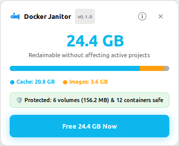
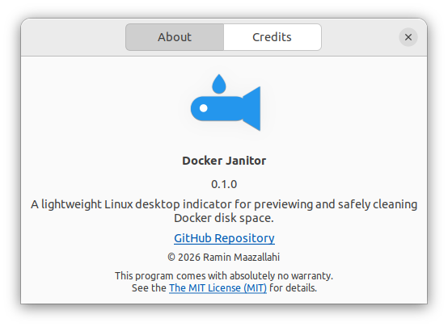

# Docker Janitor

[](https://github.com/raminmz66/docker-janitor/releases)
[](LICENSE)
[](https://www.python.org/)
[](https://www.kernel.org/)

A lightweight desktop system tray indicator for Linux that previews Docker disk space cleanup, asks for confirmation with exact numbers, and prunes only when you choose to proceed.

<p align="center">
  &nbsp;&nbsp;&nbsp;&nbsp;
  
</p>

## Highlights

- **Safety First**: Never touches or prunes volumes or containers (active or stopped). Only unreferenced images and build cache entries older than configured age thresholds are ever prunable.
- **Instant Popover HUD**: Clicking the tray icon opens a modern, frameless GTK popover immediately beneath the top panel with an instant scanning state and spinner. As Docker query data arrives, the HUD smoothly populates in-place with reclaimable storage totals, a segmented color breakdown bar, protected resource badges, and a single-click cleanup action.
- **Identity & About Dialog**: Native `Gtk.AboutDialog` accessible from both the tray menu and the HUD header bar, displaying version, authorship, license, and repository links.
- **CLI Flags**: Fast `--version` and `--help` CLI inspection without launching the GUI.
- **Auto-Dismissal**: Pressing `Escape` or clicking anywhere outside the HUD card dismisses it immediately with zero Docker mutation.
- **Single Instance**: Enforced via file lock (`$XDG_RUNTIME_DIR/docker-janitor.lock`). Launching again exits cleanly without duplicate tray icons.
- **No Background Daemon or Sudo**: Runs strictly as the current user, using your existing Docker CLI permissions and standard desktop tools (PyGObject, GTK 3, `notify-send`).

## Quick Installation

Install Docker Janitor in seconds using the automated installer:

### Method 1: Clone & Install (Recommended)

```bash
git clone https://github.com/raminmz66/docker-janitor.git
cd docker-janitor
./install.sh
```

### Method 2: One-Line Install

```bash
curl -fsSL https://raw.githubusercontent.com/raminmz66/docker-janitor/main/install.sh | bash
```

The installer:
- Checks for required system libraries (`python3-gi`, GTK 3, Ayatana AppIndicator) and helps install them if missing.
- Installs the `docker-janitor` launcher into `~/.local/bin/`.
- Configures the desktop application menu launcher and scalable SVG icons.
- Enables session autostart (`~/.config/autostart/`) so the tray indicator is ready on login.

### Installer Options

```bash
./install.sh --help

# Preview actions without making changes
./install.sh --dry-run

# Skip autostart entry
./install.sh --no-autostart

# Run non-interactively
./install.sh -y
```

### Uninstallation

To cleanly remove the application and desktop shortcuts:

```bash
./uninstall.sh

# Or to also purge configuration and state logs:
./uninstall.sh --purge
```

## CLI Usage

```bash
# Check version
docker-janitor --version
# or
python3 docker_janitor.py -v

# View command help
docker-janitor --help
# or
python3 docker_janitor.py -h
```

## Configuration

Configuration is stored in `~/.config/docker-janitor/config.env`:

```env
# Minimum age (in days) for unused images to qualify for cleanup
IMAGE_MIN_AGE_DAYS=30

# Minimum age (in hours) for build cache entries to qualify for cleanup (168h = 7 days)
CACHE_MIN_AGE_HOURS=168
```

If the file does not exist, defaults (`30` days and `168` hours) are used automatically. Comments and blank lines are ignored.

## Activity Log

Each successful prune operation appends a record to:

```
~/.local/state/docker-janitor.log
```

Log entry format:
```
2026-10-23T21:30:00+03:30 reclaimed 24.4 GB (before: 46.0 GB, after: 21.6 GB)
```

## Autostart & Disabling

Docker Janitor starts automatically on login via:

```
~/.config/autostart/docker-janitor.desktop
```

### To disable autostart:
Remove the desktop file:
```bash
rm ~/.config/autostart/docker-janitor.desktop
```
Or set `X-GNOME-Autostart-enabled=false` inside the desktop file.

### To exit:
Click the whale icon in the panel and select **Exit**.

## Running Tests

Run the full test suite using Python's built-in `unittest`:

```bash
python3 -m unittest discover -s tests -v
```

All inspection and prune tests execute against saved CLI fixtures; tests never touch live Docker daemons or issue prune commands.

## Contributing & Collaboration

We welcome contributions! Please review [CONTRIBUTING.md](CONTRIBUTING.md) for details on:
- Code guidelines and safety invariants
- Local development environment setup
- Submitting bug reports and pull requests

## Author & Maintainer

**Ramin Maazallahi**  
- GitHub: [@raminmz66](https://github.com/raminmz66)  
- Email: `r.mazallahi-ext@initiative-crm.com`

## License

This project is licensed under the MIT License — see the [LICENSE](LICENSE) file for details.
